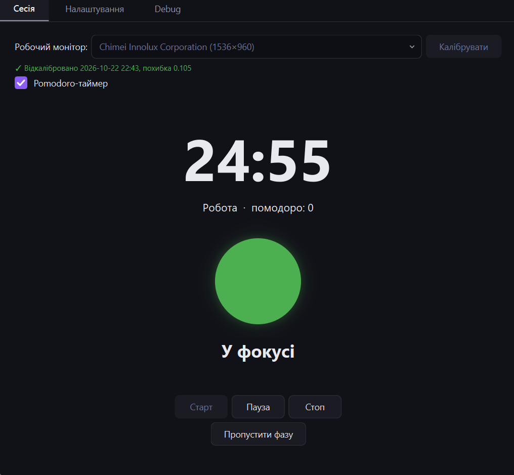
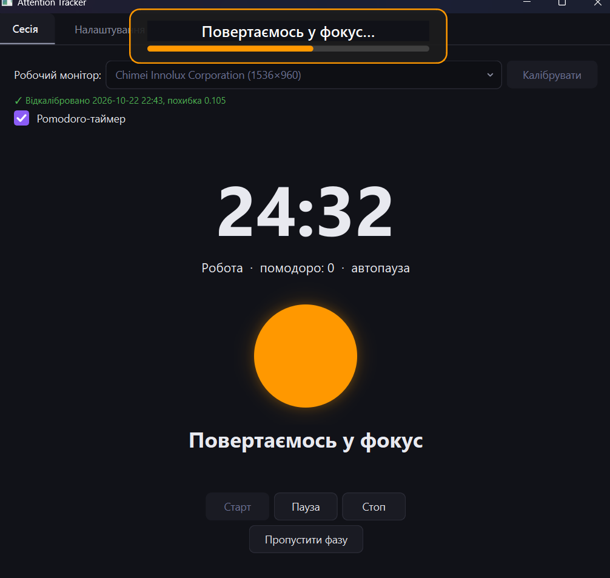
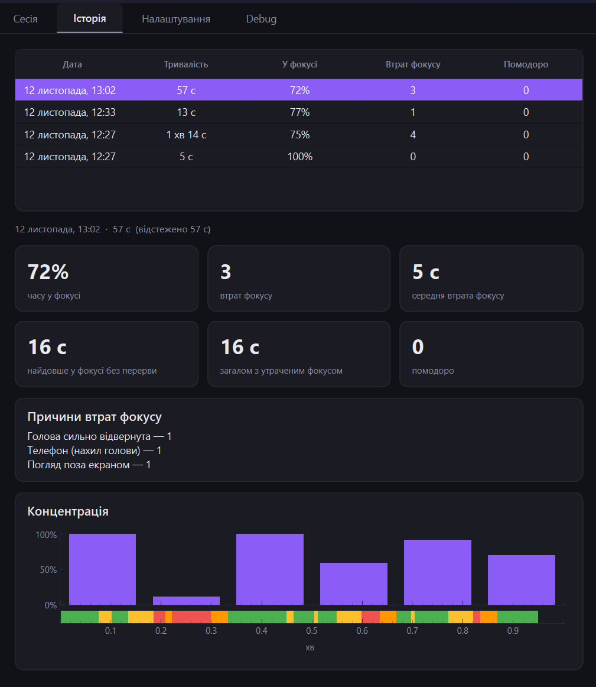

# Focus-Tracker-App


-green)


Навчальний проєкт з дисципліни «Парадигма об'єктно-орієнтованого програмування» (2025-2026)

Десктоп-застосунок для трекінгу уваги користувача через веб-камеру під час
роботи/навчання

## Можливості

- **Персональне калібрування** під користувача, робочий монітор і камеру; профілі зберігаються локально
- **Трекінг фокусу в реальному часі**: погляд поза екраном, поворот голови, погляд у телефон, відсутність за компʼютером
- **Плашка «Фокус втрачено»** поверх усіх вікон, яка не забирає фокус введення
- **Pomodoro-таймер** з автопаузою при втраті фокусу; можна працювати й без таймера
- **Підсумки сесії**: після кожної сесії — вікно з метриками (% часу у фокусі, кількість і середня тривалість втрат фокусу, найдовший відрізок у фокусі, причини відволікань) і графіком концентрації
- **Історія сесій**: усі сесії зберігаються локально; на вкладці «Історія» можна вибрати будь-яку і переглянути її підсумки
- **Налаштування**: час до втрати фокусу, час повернення, тривалості Pomodoro, звук, камера
- **Темний інтерфейс** і режим налагодження з превʼю камери та значеннями сигналів
- **Приватність**: відео й кадри не зберігаються і нікуди не передаються


| Сесія: у фокусі | Повернення у фокус після відволікання |
|---|---|
|  |  |

**Історія сесій**: таблиця всіх сесій і підсумки вибраної — метрики, причини втрат фокусу, графік концентрації.



### Як це працює

1. **Калібрування.** Користувач вибирає робочий монітор і проходить повноекранний майстер
   (~2 хв): дивиться на точки на екрані, повертає голову, дивиться на низ екрана і в
   телефон. З цих даних будується регресія «очі + поворот голови → точка погляду на
   екрані» і пороги для детекції телефона. Профіль привʼязаний до (користувач, монітор,
   камера) і стає недійсним, якщо змінилась камера, роздільна здатність або монітор.
2. **Старт сесії.** Перед кожною сесією — 2 секунди погляду в центр екрана
   (перецентрування): застосунок підлаштовується під те, як користувач сидить сьогодні,
   не змінюючи профіль.
3. **Обробка кадру** (в окремому потоці, ~25–30 кадрів/с):
   камера → 478 точок обличчя (MediaPipe) → відкритість очей (EAR), поворот голови
   (Yaw/Pitch/Roll), положення райдужок → згладжування → точка погляду на екрані →
   рішення «відволікся / ні» і причина.
4. **Машина станів** перетворює покадрові рішення на стабільний стан фокусу з
   таймерами `n` (скільки можна відволіктись) і `y` (скільки треба повернутись), з
   допуском на короткі збої детекції.
5. **Реакція:** плашка, автопауза Pomodoro, колір індикатора в головному вікні.
6. **Запис і підсумки.** Переходи станів і події Pomodoro записуються в локальну базу
   SQLite (кадри — ні). Після «Стоп» рахуються метрики сесії і відкривається вікно
   підсумків; ці ж підсумки доступні пізніше на вкладці «Історія». Враховується лише
   час, коли трекінг увімкнений: перерви й ручні паузи не рахуються.

### Як читати графік концентрації

- **Фіолетові стовпчики** — частка часу у фокусі за інтервал (10 с для сесій до 10 хв,
  1 хв для довших): 100% — увесь інтервал у фокусі, низький стовпчик — тут ви
  відволікались.
- **Кольорова смуга** під ними — стани секунда в секунду: зелений — у фокусі,
  жовтий — короткий погляд убік, червоний — фокус втрачено, помаранчевий — повернення.
- **Порожнє місце** без стовпчика і смуги — перерва або пауза, а не провал концентрації.

### Стани фокусу

| Стан | Коли | Індикатор | Плашка | Pomodoro |
|---|---|---|---|---|
| У фокусі | погляд на екрані | зелений | — | іде |
| Відволіклись | відвернулись, але менше ніж `n` с (3 с) | жовтий | — | іде |
| Фокус втрачено | відволікання ≥ `n` с | червоний | «Фокус втрачено» | пауза |
| Повертаємось у фокус | погляд повернувся, але менше ніж `y` с (2 с) | помаранчевий | прогрес повернення | пауза |

Причини відволікання (погляд поза екраном, телефон, обличчя не видно, голова сильно
відвернута) визначаються для статистики, але на плашці не показуються.

### Стан розробки

- **Готово:** захоплення і детекція обличчя, ознаки й згладжування, калібрування і
  профілі в SQLite, детектор відволікання на профілі, машина станів, перецентрування,
  плашка, Pomodoro, налаштування, темний інтерфейс, запис сесій і метрики, підсумки
  сесії з графіком концентрації, історія сесій, збірка в `.exe` (PyInstaller).

## Документація

- [`docs/PROJECT_PLAN.md`](docs/PROJECT_PLAN.md) — ідея, вимоги, архітектура, класи, етапи
- [`docs/MATH.md`](docs/MATH.md) — формули, калібрування, машина станів 
- [`CLAUDE.md`](CLAUDE.md) — правила розробки

## Структура

Пакет `attention_tracker/` (шляхи в таблиці — відносно нього).
Логіка (`vision/`, `focus/`, `calibration/`, `storage/`) — без Qt; Qt тільки в `workers/` і `ui/`.

| Шлях | Зміст |
|---|---|
| `main.py` | точка входу: тема, сховище, головне вікно |
| `config.py` | `AppConfig` — усі числові параметри |
| `models.py` | енуми `FocusState`, `Reason`, `PomodoroPhase` і dataclass-и кадру, детектора, переходів |
| `assets/` | модель MediaPipe FaceLandmarker, іконки інтерфейсу |
| `capture/` | `Camera` (вебкамера, мітки `time.monotonic()`), `FaceLandmarkerWrapper` (478 точок обличчя) |
| `vision/` | ознаки кадру (`FeatureExtractor`), згладжування (`SignalFilter`), регресія погляду (`GazeRegressor`), детектор відволікання (`DistractionDetector`) |
| `calibration/` | процедура калібрування, пороги, профіль (`CalibrationProfile`), перецентрування |
| `focus/` | машина станів (`FocusStateMachine`), `PomodoroTimer`, секундомір сесії, метрики сесії |
| `session/` | `SessionRecorder` (запис сесії в БД, відновлення обірваних сесій), підсумки сесії |
| `storage/` | `Storage` (SQLite: користувачі, профілі, налаштування, сесії, події, метрики), налаштування користувача |
| `platform/` | список моніторів, шлях до БД |
| `workers/` | `PipelineWorker` (QThread) і `FrameProcessor` — обробка кадру сесії |
| `ui/` | головне вікно, майстер калібрування, перецентрування, плашка, підсумки сесії, історія, графік концентрації, налаштування, Debug, тема |
| `tests/` | unit-тести (`pytest`), без камери |

## Стек технологій

- **Python 3.12** (підтримується 3.11)
- **MediaPipe FaceLandmarker** (Tasks API, `running_mode=VIDEO`) — 478 landmark-ів обличчя + райдужки
- **OpenCV** — захоплення відео, `solvePnP` для пози голови
- **NumPy** — обчислення
- **PySide6 (Qt)** — GUI, робочий потік (`QThread`), сигнали/слоти
- **pyqtgraph** — графіки концентрації
- **SQLite** — локальне сховище калібрувань і історії сесій
- **pytest** — тести
- Пакування: **PyInstaller**

## Зовнішні бібліотеки

Точні версії — у `requirements.txt`.

| Бібліотека | Для чого |
|---|---|
| [mediapipe](https://github.com/google/mediapipe) `0.10.35` | FaceLandmarker — landmark-и обличчя й райдужки |
| [opencv-contrib-python](https://github.com/opencv/opencv-python) `5.0.0.93` | захоплення відео, `solvePnP`/`Rodrigues` для пози голови |
| [numpy](https://numpy.org/) `2.5.3` | векторні обчислення |
| [PySide6](https://doc.qt.io/qtforpython-6/) `6.12.0` | інтерфейс і потоки |
| [pyqtgraph](https://www.pyqtgraph.org/) `0.14.0` | графіки |
| [pytest](https://docs.pytest.org/) `9.1.1` | тести |

## Запуск

```bash
python -m venv venv
venv\Scripts\activate            # Windows (macOS/Linux: source venv/bin/activate)
pip install -r requirements.txt
python -m attention_tracker.main # запуск
pytest                           # тести
```

### Збірка для Windows

```bash
pip install -r requirements-build.txt
pyinstaller packaging/attention_tracker.spec --noconfirm
```

Відео й кадри не зберігаються і нікуди не передаються — усе працює локально.

## Використання ШІ
 
Під час розробки використовується Claude Code (Anthropic).
Історія запитів зберігається; весь код переглядається й розуміється
автором.
