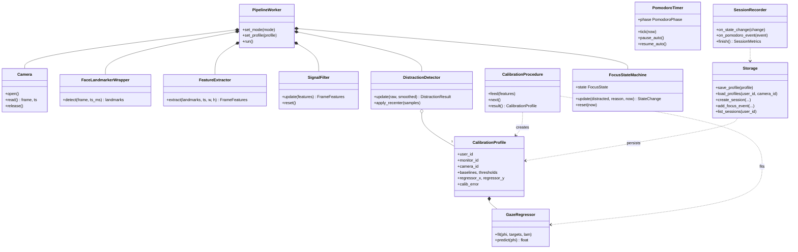
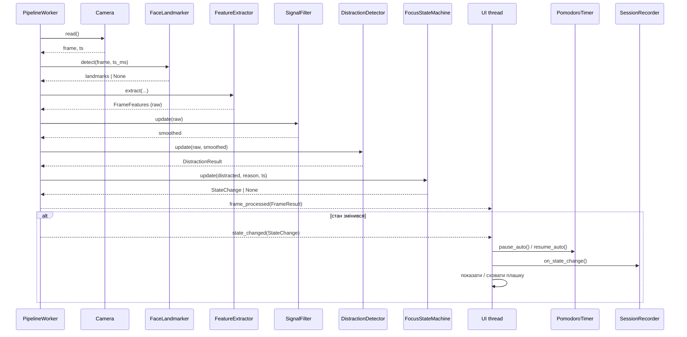
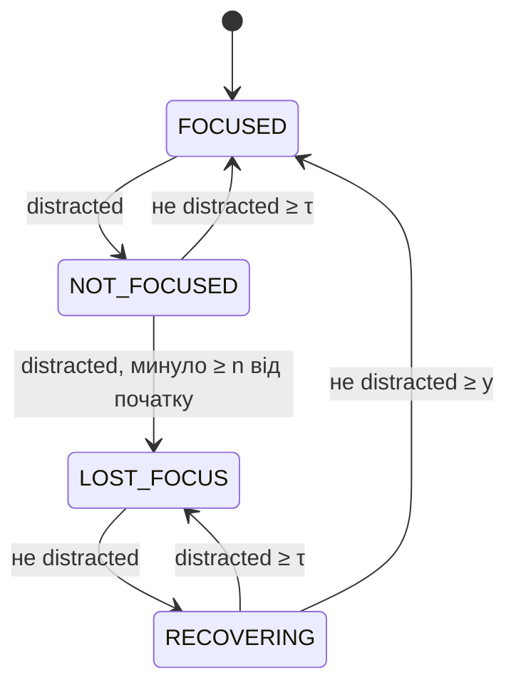
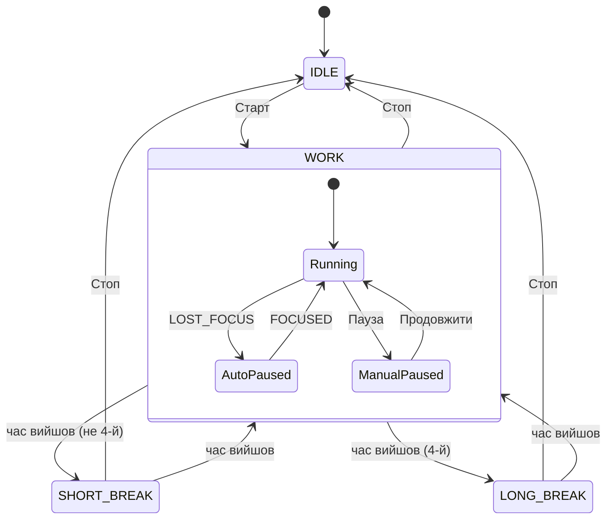
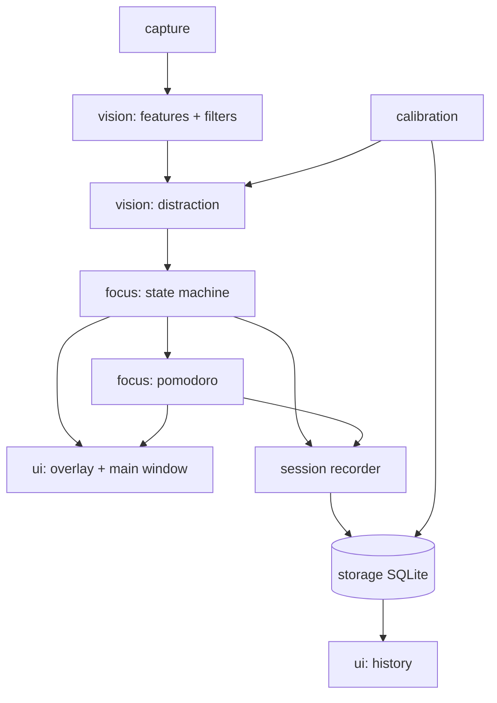

# Attention Tracker — план проєкту та архітектура

Навчальний проєкт з дисципліни «Парадигма об'єктно-орієнтованого
програмування» (2025-2026).

> **Для Claude Code.** Цей файл описує, *що* будуємо і *як* це влаштовано.
> Усі формули, пороги й кроки калібрування — у `MATH.md`, це джерело
> правди для математики. Порядок роботи і правила — у розділі 13. 

---

## 1. Ідея

Десктоп-застосунок, який під час роботи за компʼютером через вебкамеру
стежить, чи користувач зосереджений на екрані.

1. **Калібрування.** Спочатку користувач вибирає **робочий монітор** і
   калібрує застосунок під нього: дивиться на точки, повертає голову,
   дивиться на телефон. Профіль зберігається, тож калібрувати повторно
   треба тільки тоді, коли змінився монітор, камера або положення. Можна
   мати кілька збережених профілів (наприклад, ноутбук і монітор в
   офісі), але сесія завжди працює з одним.
2. **Сесія фокусу.** Користувач запускає Pomodoro-сесію. Якщо він
   відволікся (погляд поза робочим монітором, погляд у телефон, пішов з-за
   компʼютера) довше `n` секунд — поверх усіх вікон зʼявляється плашка
   **"Фокус втрачено"**, а Pomodoro-таймер ставиться на паузу. Коли погляд
   стабільно повернувся на `y` секунд — плашка зникає, таймер іде далі.
3. **Аналітика.** Для кожної сесії зберігається історія станів. Є графік
   концентрації (наживо й в історії) і статистика сесій.

Ключова відмінність від аналогів — **персональне калібрування** під
користувача і монітор, а не універсальні пороги. Це зменшує кількість
хибних спрацювань.

## 2. Аналіз аналогів

| Продукт | Що робить | Чим відрізняється наш проєкт |
|---|---|---|
| RescueTime / Timely | Трекінг активності за додатками/сайтами | Не бачить реального відволікання (телефон, погляд убік), тільки постфактум |
| Forest / Focusmate | Pomodoro з мотиваційними механіками | Таймер не знає, чи людина справді зосереджена |
| GazeRecorder, Eyeware Beam | Комерційний eye-tracking | Платні, складні, орієнтовані на heatmap-аналітику, а не на self-tracking фокусу |
| EAR-детектори сонливості | Детекція закритих очей водія | Тільки бінарна сонливість, без калібрування, Pomodoro і аналітики |

Наш проєкт поєднує в одному застосунку: (а) калібрування per-user +
per-monitor, (б) Pomodoro з авто-паузою, (в) історію сесій і графіки
концентрації.

## 3. Вимоги

### 3.1 Функціональні

| ID | Вимога |
|---|---|
| FR-1 | Вибір робочого монітора; майстер калібрування для нього (кроки 7.0–7.5 `MATH.md`), відкривається на весь екран на цьому моніторі |
| FR-2 | Збереження/перегляд/видалення профілів калібрування (user, monitor, camera) |
| FR-3 | Визначення стану фокусу в реальному часі: 4 стани (`MATH.md` §6) |
| FR-4 | Плашка поверх усіх вікон у `LOST_FOCUS`/`RECOVERING`, яка не забирає фокус введення |
| FR-5 | Pomodoro: робота / коротка перерва / довга перерва; авто-пауза в `LOST_FOCUS`/`RECOVERING` |
| FR-6 | Швидке перецентрування на початку сесії (§7.6) |
| FR-7 | Живий графік концентрації поточної сесії |
| FR-8 | Історія сесій: список, метрики (§8), графік кожної сесії |
| FR-9 | Налаштування: `n`, `y`, тривалості Pomodoro, камера, звук/без звуку |
| FR-10 | Попередження на старті сесії, якщо для робочого монітора немає профілю або профіль недійсний (змінилась камера/роздільна здатність) |
| FR-11 | Режим налагодження: превʼю камери з landmark-ами, значеннями сигналів і точкою погляду |

### 3.2 Нефункціональні

- Обробка ≥ 15 FPS на звичайному ноутбуці; UI не підвисає.
- **Приватність:** відео й кадри не зберігаються і не передаються. Все
  працює локально, без мережі.
- Камера звільняється, коли немає активної сесії/калібрування.
- Windows 10/11 (основна платформа); macOS/Linux — бажано.

### 3.3 Поза обсягом (не реалізовувати)

- **Кілька моніторів одночасно.** Сесія працює з одним робочим монітором.
  Погляд на інший монітор вважається відволіканням. Можливе розширення в
  майбутньому: окремий профіль на кожен монітор і перевірка "погляд
  всередині хоча б одного".

## 4. Стек

- **Python 3.11 або 3.12** (перевірити наявність wheel `mediapipe` для вибраної версії)
- **mediapipe** — `FaceLandmarker` (Tasks API), модель `face_landmarker.task`
  лежить у `assets/`
- **opencv-python** — захоплення кадрів, `solvePnP`
- **numpy** — обчислення, ridge-регресія
- **PySide6** — GUI, потоки (`QThread`), сигнали/слоти
- **pyqtgraph** — графіки
- **sqlite3** (стандартна бібліотека) — сховище
- **pytest** — тести
- Пакування: **PyInstaller**

## 5. Архітектура

### 5.1 Шари

```
Camera (OpenCV)
   │ кадр + timestamp
   ▼
FaceLandmarker (MediaPipe)
   │ 478 landmarks або None
   ▼
FeatureExtractor  ── EAR, Yaw/Pitch/Roll, Gaze_h/Gaze_v           (MATH §1–3.1)
   │
   ▼
SignalFilter      ── median + EMA                                (MATH §5)
   │
   ▼
DistractionDetector ── регресія → (sx,sy), пороги                (MATH §3.2–4)
   │ distracted, reason
   ▼
FocusStateMachine ── 4 стани                                     (MATH §6)
   │ state changes
   ├──▶ PomodoroTimer (авто-пауза)
   ├──▶ Overlay (плашка)
   ├──▶ MainWindow (індикатор, графік)
   └──▶ SessionRecorder → Storage (SQLite)
```

### 5.2 Потоки

- **`PipelineWorker` (QThread):** камера → landmarker → features → filter →
  detector → state machine. Наружу видає тільки Qt-сигнали.
- **Головний (UI) потік:** вікна, плашка, `PomodoroTimer` (тік через
  `QTimer` 1 с), `SessionRecorder`, `Storage`.
- SQLite-зʼєднання створюється і використовується **тільки в головному
  потоці**. Worker нічого не пише в БД напряму.
- Логіка (features, filter, detector, state machine, pomodoro, metrics,
  calibration fitting) — **чисті Python-класи без Qt**. Вони отримують час
  як аргумент `now: float`. Qt є тільки в `workers/` і `ui/`.

### 5.3 Сигнали `PipelineWorker`

| Сигнал | Payload | Частота |
|---|---|---|
| `frame_processed` | `FrameResult` | кожен кадр (UI може проріджувати до ~10 Гц) |
| `state_changed` | `StateChange(ts, old, new, reason)` | при переході |
| `calibration_sample` | `FrameFeatures` (сирі) | кожен кадр у режимі калібрування |
| `camera_error` | `str` | при помилці |
| `fps_updated` | `float` | раз на секунду |

Режими worker-а: `IDLE` (камера вимкнена), `CALIBRATION` (тільки
features, без детектора/SM), `SESSION` (повний пайплайн), `PAUSED`
(перерва Pomodoro: кадри обробляються, SM не оновлюється).

### 5.4 Звʼязок з Pomodoro

- У робочій фазі SM активна. На `LOST_FOCUS` → `pomodoro.pause_auto()`. На
  `FOCUSED` після `RECOVERING` → `pomodoro.resume_auto()`.
- Ручна пауза користувача має пріоритет: авто-resume не знімає ручну паузу.
- Під час перерв worker у режимі `PAUSED`, плашка прихована. На старті
  нової робочої фази SM скидається у `FOCUSED`.

## 6. Структура проєкту

```
attention_tracker/
├── main.py                     # точка входу, створення QApplication
├── config.py                   # dataclass AppConfig з дефолтами (MATH §9)
├── models.py                   # dataclass-и та enum-и (розділ 7.1)
├── assets/face_landmarker.task
├── capture/
│   ├── camera.py               # Camera: open/read/release, camera_id
│   └── landmarker.py           # FaceLandmarkerWrapper.detect(frame, ts_ms) -> np.ndarray|None
├── vision/
│   ├── landmarks.py            # константи індексів (MATH §0.1), 3D-модель (§2.1)
│   ├── features.py             # ear(), head_pose(), gaze_raw() — чисті функції
│   ├── filters.py              # MedianEmaFilter, SignalFilter
│   ├── gaze_model.py           # GazeRegressor: fit(), predict(), to_dict()/from_dict()
│   └── distraction.py          # DistractionDetector
├── calibration/
│   ├── profile.py              # CalibrationProfile
│   ├── procedure.py            # CalibrationProcedure — кроки, збір, robust mean, перевірки (без Qt)
│   └── fitting.py              # обчислення порогів (§7.2) і регресії (§7.4)
├── focus/
│   ├── state_machine.py        # FocusStateMachine
│   ├── pomodoro.py             # PomodoroTimer (логіка без Qt)
│   └── metrics.py              # compute_metrics(), focus_timeline()
├── storage/
│   ├── schema.sql
│   └── storage.py              # Storage — єдина точка доступу до SQLite
├── session/
│   └── recorder.py             # SessionRecorder: пише події сесії в Storage
├── workers/
│   └── pipeline_worker.py      # PipelineWorker(QThread)
├── platform/
│   └── monitors.py             # MonitorInfo з QScreen, monitor_id
└── ui/
    ├── main_window.py          # головне вікно: старт/стоп, стан, таймер, живий графік
    ├── calibration_window.py   # повноекранний майстер на вибраному моніторі
    ├── overlay.py              # плашка "Фокус втрачено"
    ├── history_view.py         # історія сесій + графік вибраної сесії
    ├── settings_dialog.py
    ├── debug_view.py           # превʼю камери з landmark-ами (FR-11)
    └── charts.py               # обгортки pyqtgraph
tests/
├── test_features.py
├── test_filters.py
├── test_gaze_model.py
├── test_distraction.py
├── test_state_machine.py
├── test_pomodoro.py
├── test_calibration_fitting.py
├── test_metrics.py
└── test_storage.py
```

## 7. Класи

### 7.1 Моделі даних (`models.py`)

```python
class FocusState(Enum): FOCUSED, NOT_FOCUSED, LOST_FOCUS, RECOVERING
class Reason(Enum): NONE, GAZE_OUT, PHONE_EYES, PHONE_HEAD, FACE_ABSENT, HEAD_AWAY
class PomodoroPhase(Enum): IDLE, WORK, SHORT_BREAK, LONG_BREAK

@dataclass(frozen=True)
class FrameFeatures:            # сирі значення одного кадру
    ts: float                   # time.monotonic()
    valid: bool                 # обличчя знайдено і solvePnP ok
    ear: float | None
    yaw: float | None; pitch: float | None; roll: float | None   # градуси
    gaze_h: float | None; gaze_v: float | None
    iris_distance_px: float | None

@dataclass(frozen=True)
class DistractionResult:
    ts: float
    distracted: bool
    reason: Reason
    screen_point: tuple[float, float] | None   # (sx, sy) на робочому моніторі

@dataclass(frozen=True)
class StateChange:
    ts: float; old: FocusState; new: FocusState; reason: Reason

@dataclass(frozen=True)
class FrameResult:
    features: FrameFeatures
    distraction: DistractionResult | None
    state: FocusState | None
    recovering_progress: float | None   # 0..1 у RECOVERING
```

### 7.2 Основні класи

| Клас | Відповідальність | Ключові методи |
|---|---|---|
| `Camera` | доступ до вебкамери | `open(index, w, h)`, `read() -> (frame, ts)`, `release()`, `camera_id` |
| `FaceLandmarkerWrapper` | MediaPipe | `detect(frame_bgr, ts_ms) -> np.ndarray(478,3) | None` |
| `FeatureExtractor` | §1–3.1 | `extract(landmarks, ts, frame_w, frame_h) -> FrameFeatures` (тримає prev rvec/tvec) |
| `SignalFilter` | §5 | `update(FrameFeatures) -> FrameFeatures`, `reset()` |
| `GazeRegressor` | §3.3, §7.4 | `fit(phi, targets, lam)`, `predict(phi) -> float`, серіалізація |
| `DistractionDetector` | §3.2–4 | `__init__(profile: CalibrationProfile, cfg)`, `update(raw, smoothed) -> DistractionResult`, `apply_recenter(...)` |
| `FocusStateMachine` | §6 | `update(distracted, reason, now) -> StateChange | None`, `reset(now)`, `set_timings(n, y)`, `state`, `recovering_progress(now)` |
| `PomodoroTimer` | Pomodoro | `start()`, `tick(now)`, `pause_manual()`, `resume_manual()`, `pause_auto()`, `resume_auto()`, `skip_phase()`, `stop()`; події через callback |
| `CalibrationProcedure` | кроки §7 | `current_step`, `feed(FrameFeatures)`, `step_status`, `next()`, `result() -> CalibrationProfile` |
| `CalibrationProfile` | дані §7.7 | `to_json()`, `from_json()`, `is_valid_for(monitor_id, camera_id, w, h)` |
| `Storage` | SQLite | див. §9 |
| `SessionRecorder` | запис сесії | `on_state_change`, `on_pomodoro_event`, `finish() -> SessionMetrics` |
| `PipelineWorker` | потік | `set_mode(mode)`, `set_profile(profile)`, `set_timings(n, y)`, сигнали §5.3 |
| `MonitorInfo` | монітор | `monitor_id`, `name`, `geometry`, `from_qscreen(screen)` |

`monitor_id` = `f"{manufacturer}|{model}|{serialNumber}"` з `QScreen`. Якщо
поля порожні — `f"{name}|{width}x{height}"`.

### 7.3 Class diagram



## 8. UI

### 8.1 Головне вікно

- Вибір користувача (за замовчуванням один локальний "Default").
- Випадний список **"Робочий монітор"** (з `QGuiApplication.screens()`,
  за замовчуванням основний; вибір зберігається в `settings`). Поруч статус
  калібрування (✔ + дата і точність / "не відкалібровано" / "профіль
  недійсний") і кнопка **"Калібрувати"**. Без дійсного профілю кнопка
  "Старт" неактивна.
- Кнопки **Старт / Пауза / Стоп / Пропустити фазу**.
- Великий таймер Pomodoro, назва фази, лічильник помодоро.
- Індикатор стану (колір і текст за таблицею `MATH.md` §6).
- Живий графік `focus_share` (біни 10 с) + смуга станів кольорами.
- Вкладки: **Сесія**, **Історія**, **Налаштування**, **Debug**.

### 8.2 Майстер калібрування

Повноекранне вікно на вибраному моніторі, темний фон. Покроково:
інструкція → відлік → ціль (точка, яка "стискається" за `T_calib`). Для
кроку 3 — індикатор кута голови (сірий → зелений, коли кут у діапазоні). На
кроці 5 — звуковий сигнал початку й кінця. У кінці — перевірка точності
(§7.5) з результатом і кнопками "Зберегти" / "Повторити". `Esc` —
скасувати.

### 8.3 Плашка (`overlay.py`)

- `QWidget` з прапорцями
  `Qt.WindowStaysOnTopHint | Qt.FramelessWindowHint | Qt.Tool` і атрибутами
  `WA_ShowWithoutActivating`, `WA_TranslucentBackground`. **Не забирає фокус**
  у вікна, де працює користувач.
- Показується на робочому моніторі, вгорі по центру.
- `LOST_FOCUS`: "Фокус втрачено", без причини. Причина відволікання
  записується тільки в історію сесії (`focus_events.reason`) для статистики.
- `RECOVERING`: "Повертаємось у фокус…" + прогрес-бар `recovering_progress`.
- Плавна поява/зникання (200 мс).
- Опційно: прозорість для кліків мишею (`WindowTransparentForInput`).

### 8.4 Історія

Таблиця сесій (дата, тривалість, кількість помодоро, `focus_ratio`,
`n_lost_episodes`). Клік → графік `focus_share` (біни 60 с), смуга станів,
розподіл причин відволікання.

### 8.5 Налаштування

Таймери машини станів (`MATH.md` §6), поля з поясненням під кожним:

| Поле в UI | Параметр | За замовч. | Діапазон | Підказка під полем |
|---|---|---|---|---|
| "Час до втрати фокусу" | `n` | 3 с | 1–30 с, крок 0.5 | "Скільки секунд можна дивитись убік, поки не зʼявиться плашка" |
| "Час повернення у фокус" | `y` | 2 с | 0.5–15 с, крок 0.5 | "Скільки секунд треба дивитись на екран, щоб плашка зникла і таймер продовжився" |

Зберігаються в таблиці `settings` і застосовуються одразу, зокрема в
поточній сесії (`PipelineWorker.set_timings(n, y)` → `FocusStateMachine`).
Кнопка "Скинути до стандартних".

Також: тривалість роботи/перерв, кількість помодоро до довгої перерви,
камера (індекс + роздільна здатність, за замовчуванням 1280×720 або 640×480),
звук.

## 9. Сховище (SQLite)

```sql
CREATE TABLE users (
    id INTEGER PRIMARY KEY,
    name TEXT NOT NULL UNIQUE,
    created_at TEXT NOT NULL
);

CREATE TABLE calibration_profiles (
    id INTEGER PRIMARY KEY,
    user_id INTEGER NOT NULL REFERENCES users(id),
    monitor_id TEXT NOT NULL,
    monitor_name TEXT,
    camera_id TEXT NOT NULL,
    frame_w INTEGER NOT NULL,
    frame_h INTEGER NOT NULL,
    data_json TEXT NOT NULL,          -- усі поля CalibrationProfile (MATH §7.7)
    calib_error REAL NOT NULL,
    schema_version INTEGER NOT NULL,
    created_at TEXT NOT NULL,
    UNIQUE (user_id, monitor_id, camera_id)   -- нове калібрування замінює старе
);

CREATE TABLE sessions (
    id INTEGER PRIMARY KEY,
    user_id INTEGER NOT NULL REFERENCES users(id),
    started_at TEXT NOT NULL,         -- ISO 8601, локальний час
    ended_at TEXT,
    settings_json TEXT NOT NULL,      -- n, y, тривалості на момент старту
    monitor_id TEXT NOT NULL,         -- робочий монітор сесії
    profile_id INTEGER REFERENCES calibration_profiles(id)
);

CREATE TABLE focus_events (           -- тільки переходи станів, НЕ кожен кадр
    id INTEGER PRIMARY KEY,
    session_id INTEGER NOT NULL REFERENCES sessions(id),
    t_offset REAL NOT NULL,           -- секунди від початку сесії (monotonic)
    from_state TEXT NOT NULL,
    to_state TEXT NOT NULL,
    reason TEXT NOT NULL
);

CREATE TABLE pomodoro_events (
    id INTEGER PRIMARY KEY,
    session_id INTEGER NOT NULL REFERENCES sessions(id),
    t_offset REAL NOT NULL,
    event TEXT NOT NULL,              -- phase_start, phase_end, auto_pause, auto_resume, manual_pause, manual_resume, stop
    phase TEXT NOT NULL
);

CREATE TABLE session_metrics (        -- кеш MATH §8, рахується при завершенні сесії
    session_id INTEGER PRIMARY KEY REFERENCES sessions(id),
    t_focused REAL, t_not_focused REAL, t_lost REAL,
    focus_ratio REAL, n_lost_episodes INTEGER,
    mean_lost_duration REAL, longest_focus REAL,
    n_pomodoros INTEGER,
    lost_by_reason_json TEXT
);

CREATE TABLE settings (key TEXT PRIMARY KEY, value TEXT NOT NULL);
```

БД лежить у теці даних користувача (`QStandardPaths.AppDataLocation`).
Зміни схеми — через `PRAGMA user_version` і прості міграції в `Storage`.
Якщо застосунок упав, незавершені сесії (`ended_at IS NULL`) закриваються
при наступному запуску за часом останньої події.

## 10. Діаграми

### 10.1 Use Case

Актор: **Користувач**

- Відкалібрувати монітор
- Переглянути / видалити профіль калібрування
- Почати / поставити на паузу / зупинити Pomodoro-сесію
- Отримати плашку й авто-паузу при відволіканні
- Переглянути живий графік концентрації
- Переглянути історію та статистику сесій
- Змінити налаштування

### 10.2 Sequence (один кадр у сесії)



### 10.3 Машина станів



### 10.4 Pomodoro



### 10.5 Компоненти



Усі компоненти працюють локально на одному компʼютері, сервера немає.

## 11. Етапи

### Етап 1 — ідея (документи)
Тема, стек, аналоги, use case, чернетки діаграм — цей файл і `MATH.md`.

### Етап 2 — альфа
1. `capture`, `vision/features.py`, `vision/filters.py` + `debug_view` з
   landmark-ами та значеннями EAR/Yaw/Pitch/Gaze.
2. `FocusStateMachine` + тести.
3. `DistractionDetector` на **тимчасових порогах** з `config.py` (без
   регресії: `gaze_out = |Gaze_h − 0.5| > 0.15 OR |ΔYaw| > 25°`, baseline
   береться з перших 2 с сесії).
4. Мінімальний UI: старт/стоп, індикатор стану, плашка.

### Етап 3 — фінал
1. Вибір робочого монітора, повне калібрування (`MATH.md` §7), профілі в SQLite.
2. Регресія погляду, пороги з калібрування, перецентрування.
3. Pomodoro з авто-паузою.
4. `SessionRecorder`, метрики, живий графік, історія.
5. Налаштування, пакування PyInstaller.
6. Оновлений аналіз аналогів.

## 12. Тестування і критерії готовності

### 12.1 Unit-тести (обовʼязкові, без камери)

- `features`: синтетичні landmark-и. Райдужка зсунута вправо в кадрі → обидва
  `g_eye` зростають. EAR для відомої геометрії. Head pose для фронтального
  обличчя ≈ (0,0,0). `wrap()` на межах ±180.
- `filters`: одиничний викид прибирається медіаною; `reset()` працює.
- `gaze_model`: на синтетичних даних з відомою залежністю похибка < 0.02;
  серіалізація туди-назад дає ідентичний прогноз.
- `distraction`: гістерезис меж; `T_blink` (0.3 с низького EAR — не тригер,
  0.6 с — тригер); короткий збій обличчя < `T_noface` тримає стан; довгий
  → `FACE_ABSENT`.
- `state_machine`: таймлайни подій з явним `now` на всі переходи §6, зокрема:
  повернення < τ не скидає n; зрив у `RECOVERING` → `LOST_FOCUS`; повний
  цикл.
- `pomodoro`: авто-пауза не знімає ручну; зміна фаз; час на паузі не
  рахується.
- `calibration_fitting`: пороги §7.2 для обох гілок (`ear_enabled` true/false).
- `metrics`: відомий список подій → відомі метрики.
- `storage`: на БД `:memory:`.

### 12.2 Ручна перевірка (критерії приймання)

| Сценарій | Очікування |
|---|---|
| Дивлюсь у будь-яку точку екрана, зокрема в кути й низ, 5 хв | Жодного `LOST_FOCUS` |
| Моргаю, читаю текст унизу екрана | Жодного `LOST_FOCUS` |
| Відвертаюсь убік > 3 с | Плашка через ~3 с, Pomodoro на паузі |
| Беру телефон, дивлюсь у нього > 3 с | Плашка; в історії причина `PHONE_EYES` / `PHONE_HEAD` |
| Встаю з-за компʼютера | Плашка; в історії причина `FACE_ABSENT` |
| Повертаюсь і дивлюсь на екран 2 с | Плашка зникає, таймер іде |
| Під час повернення на мить відвернувся (> τ) | Знову "Фокус втрачено", відлік y заново |
| Дивлюсь на другий монітор (якщо є) або на стіну поруч з екраном | Відволікання |
| Немає профілю для робочого монітора | "Старт" неактивний, підказка відкалібрувати |
| Працюю у вікні, зʼявляється плашка | Введення з клавіатури не переривається |

## 13. Правила для реалізації (для Claude Code)

1. **Реалізовуй по етапах з розділу 11**, у вказаному порядку. Після
   кожного пункту — тести з §12.1 для нього, `pytest` має проходити.
2. **Формули — дослівно з `MATH.md`.** Посилань на розділи документів
   (`MATH §…`, `PROJECT_PLAN §…`, `FR-…`) у коді не пиши — ні в docstring-ах,
   ні в коментарях.
3. Логіка без Qt і з явним `now: float` — щоб тести не залежали від часу й
   камери. Не використовуй `time.time()` у логіці; час приходить ззовні.
4. **Не дзеркаль кадр** перед обробкою. **Не рахуй час кадрами.**
5. **Не пиши в SQLite з worker-потоку.** Не роби UI-операцій поза головним
   потоком.
6. **Не зберігай і не відправляй кадри/відео** нікуди.
7. Усі числові параметри — в `config.py` (`AppConfig`), а не магічні числа
   в коді.
8. Type hints скрізь, `dataclass`-и для даних, `Enum` для станів.
9. Якщо MediaPipe не знайшов обличчя або `solvePnP` не зійшовся — це
   звичайна ситуація (`valid=False`), а не виняток.
10. Якщо щось у документах неоднозначне чи нереалізовне — зупинись і спитай.
